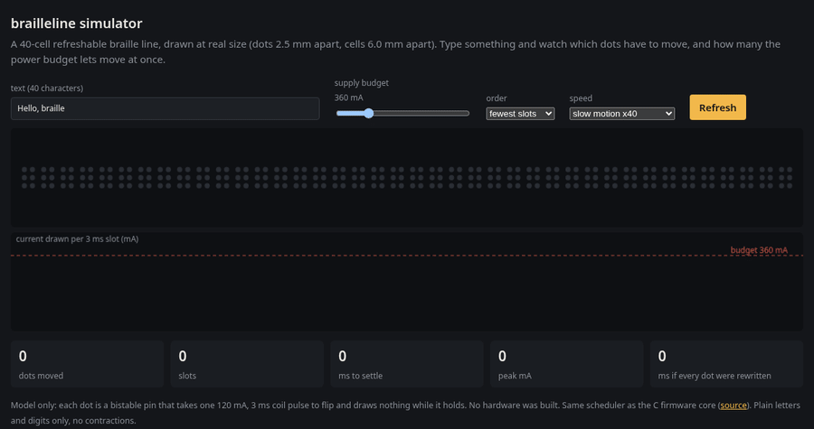

# brailleline



Controller firmware core for a DIY refreshable braille line: it takes text, works out which dots actually have to move, and fires the coils in an order that never goes over your power supply. Plain C99, 1.8 KB of code on a Cortex-M0+, with a browser simulator to try it.

**Try it:** https://tahakocp.github.io/brailleline/ (nothing to install)

Nothing here has been run on a real braille display. No cell, coil or board was built. What exists and is tested is the controller logic, against a model of the actuator.

## Why this exists

Commercial braille displays cost thousands of dollars. Two open designs for cheap ones appeared recently: [MagnePins](https://dl.acm.org/doi/10.1145/3746059.3747692) (ACM UIST 2025, 2.5 mm pins, 15 ms electromagnet pulses, about 8 A when eight fire together) and [FoldedFlex](https://github.com/saadcaffeine/foldedflex) (coils folded out of flex PCB, a modelled 0.43 A and 77 mJ per 10 ms flip, not fabricated yet). Both are about the mechanism. Both leave the same question open: when a new line of text arrives, in what order do you fire the coils so the supply survives?

A latching pin holds with zero power but needs a short, hard pulse to change. Fire all 240 dots of a 40-cell line at once and you need amps. Fire one at a time and a refresh takes a second. So there is a schedule to compute, and that is what this repo does.

## What it does

```
$ build/blcli "Hello, world" 360
slot  0 (3000 us): cell7.dot2^ cell9.dot1^ cell0.dot1^
slot  1 (3000 us): cell2.dot1^ cell3.dot1^ cell4.dot1^
...
slot 10 (3000 us): cell10.dot3^ cell11.dot5^
⠓⠑⠇⠇⠕⠠⠀⠺⠕⠗⠇⠙
11 slots, 32 dot pulses, 33000 us total at 360 mA (3 at once)
```

- compares the new line with the dots that are up now and pulses only the difference
- allows `budget_mA / pulse_mA` coils at the same time, and one coil per cell per slot (the driver row is shared)
- two orders: fewest slots, or leftmost cells first so text settles in reading order
- a small framed serial protocol with CRC and resync after noise ([docs/protocol.md](docs/protocol.md))
- a hook (`hal` callback) that receives each slot; your code turns that into shift register writes
- a JavaScript port that runs the same plan in the browser, checked against the C code with generated vectors

## Numbers

Measured here with `make bench`: 21 lines of a public domain novel, word-wrapped to 40 cells, each line replacing the previous one. Pulse 120 mA, 3 ms (a made-up generic coil; the simulator also has the published FoldedFlex and MagnePins figures).

| coils at once | slots per line | refresh, fewest slots | refresh, reading order | rewrite every dot |
|---|---|---|---|---|
| 1 (120 mA) | 99.7 | 299 ms | 299 ms | 720 ms |
| 2 (240 mA) | 50.1 | 150 ms | 152 ms | 360 ms |
| 4 (480 mA) | 25.4 | 76 ms | 79 ms | 180 ms |
| 8 (960 mA) | 13.0 | 39 ms | 43 ms | 90 ms |

Next-line text moves about 100 of the 240 dots, so skipping the unchanged ones is a bit more than a factor 2. Reading order costs 1 to 10 percent more time. With the FoldedFlex numbers (430 mA, 10 ms) the same line takes 254 ms at 4 coils at once, 997 ms at one.

Other measurements:

| | |
|---|---|
| code size, Cortex-M0+, `-Os`, GCC 15 | 1,791 bytes |
| stack in a SET_LINE for 80 cells | about 3.3 KB (the plan lives on the stack) |
| `bl_dev` state | 120 bytes |
| C tests | 80,022 checks, also under ASan and UBSan |
| JS against C | 761 checks on vectors generated by the C code |
| frames through random noise, idle gap before each | 3000 of 3000 |

The schedule is checked against the lower bound `max(largest per-cell backlog, ceil(dots / coils))` on 20,000 random lines; it hits the bound every time. That is a small scheduling result, nothing deep. The value is having it written, tested, and usable instead of everyone hard-coding a fixed fire order.

## Use

```sh
make test          # build, test C, check the JS port against the C code
make bench         # the table above
build/blcli "text" 480
```

In firmware:

```c
bl_dev d;
bl_dev_init(&d, 40, /*budget mA*/ 480, /*pulse mA*/ 120, /*pulse us*/ 3000);
d.hal = my_fire_slot;          /* void (*)(void *ctx, const bl_pulse *p, int n, uint32_t us) */
/* for every byte from the UART: */
if (bl_parser_feed(&parser, byte))
    reply_len = bl_dev_handle(&d, parser.cmd, parser.payload, parser.len, reply);
```

`my_fire_slot` gets up to `budget / pulse_mA` pulses, each a cell, a dot number and a direction. Drive them for `us` microseconds, then return.

## What is new, and what is not

- [BRLTTY](https://github.com/brltty/brltty) (125 stars) is the host-side driver layer for existing displays. [liblouis](https://github.com/liblouis/liblouis) (358) does translation. Neither is device firmware, and this repo uses neither yet.
- [MagnePins](https://dl.acm.org/doi/10.1145/3746059.3747692) and [FoldedFlex](https://github.com/saadcaffeine/foldedflex) are mechanisms. MagnePins fires on a fixed carriage schedule; FoldedFlex has no controller yet. This is a controller that fits designs like those.
- The older GitHub prototypes I found ([braillejs/solenoid-prototype](https://github.com/braillejs/solenoid-prototype), 28 stars, last pushed 2019, and a few smaller ones) drive solenoids directly with no scheduling and no tests.

I found no open power-budget scheduler or tested controller core for refreshable braille. I did not find every project in existence, so I am not claiming it is the first.

## Not done, not tested

- no real hardware of any kind; the pulse model is an assumption and may be wrong for your coils
- thermal limits per coil are not modelled
- no key or routing-button events, no BRLTTY driver, no 8-dot or contracted braille (letters, digits and punctuation from the North American ASCII table only, no capital signs)
- no HAL for a real chip; the size numbers are from compiling the core only
- the plan array sits on the stack, which is too much for the smallest parts without trimming `BL_MAX_CELLS`

## Help wanted

If you build a braille cell and have real pulse current and time, open an issue with the [hardware report](.github/ISSUE_TEMPLATE/hardware-report.md) template. See [CONTRIBUTING.md](CONTRIBUTING.md) for the other open pieces.

MIT, see LICENSE. The cell dimensions in the simulator (2.5 mm dot spacing, 6.0 mm cell spacing) are from the Marburg Medium and IADD/BANA specifications.
